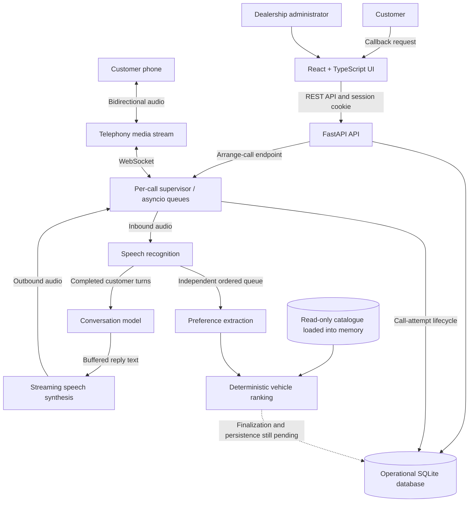
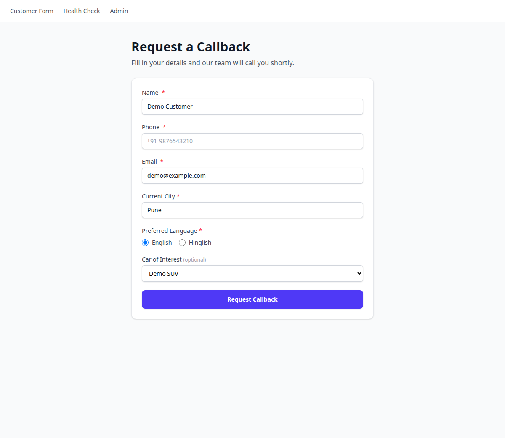
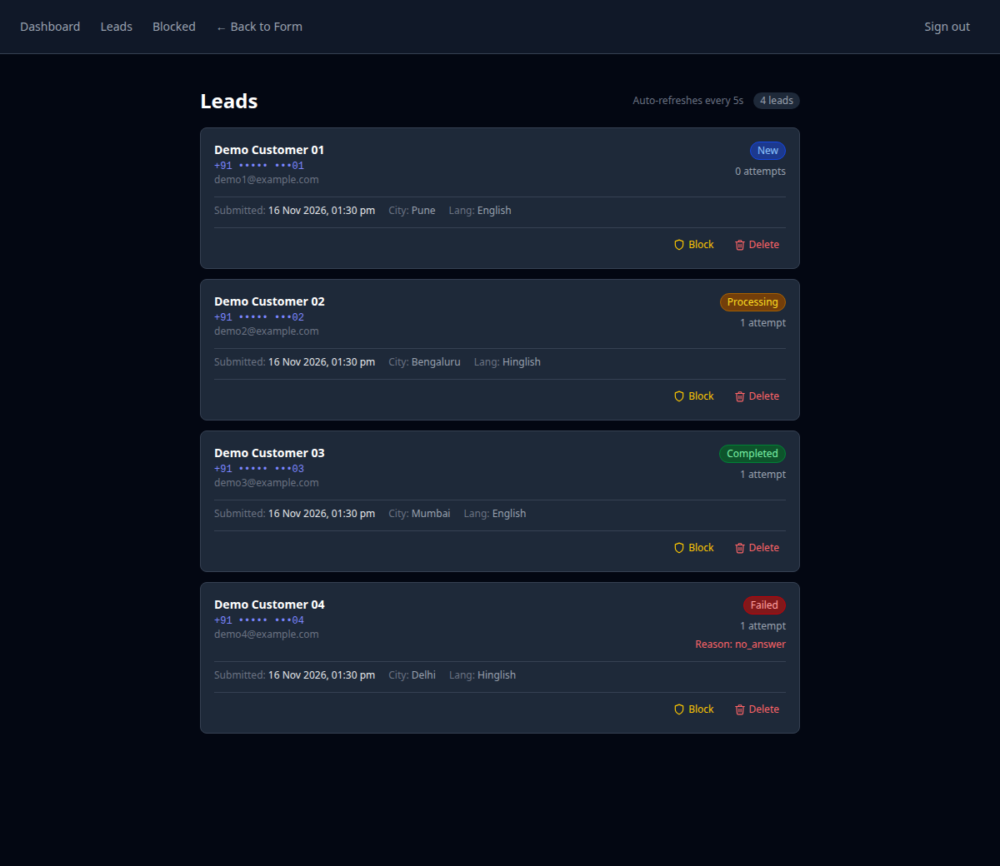

# Car Phone Call Assistance

**AI voice consultation for car dealerships, from callback request to structured buying preferences.**

A customer requests a callback, an administrator initiates a phone consultation through the backend, and **Riya** asks about their car-buying needs in **English or Hinglish**. A background matcher extracts preferences and ranks vehicles while the conversation continues.

**Stack:** React · TypeScript · Tailwind CSS · FastAPI · Python asyncio · WebSockets · SQLite

- **Built:** customer intake, authenticated lead management, outbound-call orchestration, bidirectional audio, and interruption handling.
- **In progress:** final recommendation handoff, persisted call artifacts, and the complete admin call workflow.
- **Verified:** 353 resource-independent backend tests passed; the frontend production build passed.

[Architecture](#system-architecture) · [Screenshots](#screenshots) · [Implementation status](#implementation-status) · [Setup](#install)

## System architecture

Solid connections show implemented paths. The dashed connection shows the remaining recommendation handoff.



**Engineering decisions**

- Keep the voice pipeline asynchronous; run preference extraction outside the conversation's critical path.
- Process preferences in arrival order so the latest explicit customer statement wins.
- Tag outbound audio by generation, clear queued playback on interruption, and cancel stale synthesis.
- Give each call one supervisor for task ownership and idempotent teardown; borrow database connections per operation with WAL and transactions.

## Screenshots

Actual application screens captured locally with **mocked API responses and synthetic demo data**. Contact numbers in the dashboard are masked. These images demonstrate the existing UI, not a live call or a production deployment.

**Customer callback request** — contact details, searchable city input, language preference, and optional car interest.



**Administrator lead dashboard** — status badges, attempt counts, periodic refresh, and block/delete actions.



## Implementation status

Statuses describe the checked-in source. **Completed** means the component is implemented; **Partial** means part of its user workflow or integration remains; **Planned** means the capability is still to be built. This public snapshot requires private runtime setup before real calls.

| Capability | Status | What is implemented / what remains |
|---|---|---|
| Customer callback form | Completed | Form validation, Indian mobile normalization, fuzzy city search, English/Hinglish selection, and optional vehicle interest. |
| Submission controls | Completed | Duplicate-active-lead prevention, block checks, and per-IP rate limiting. |
| Admin authentication and lead management | Completed | Password hashing, server-side sessions, CSRF checks, lead/history display, polling, delete, block, and unblock. |
| Backend outbound calls | Completed | Arrange-call endpoint, call-attempt tracking, concurrency limits, answering-machine callbacks, and centralized teardown. |
| Voice conversation and interruptions | Completed | Bidirectional audio bridge, speech recognition, conversation replies, streaming synthesis, stale-audio rejection, and barge-in state handling. |
| Recommendation components | Completed | Ordered preference extraction, deterministic vehicle ranking, and a separate recommendation-text formatter. |
| Final recommendation workflow | Partial | Matching runs alongside calls; finalization, saved recommendations, and real matcher-usability checks in call outcome handling remain. |
| Transcript and recording access | Partial | Schema, in-memory interruption metadata, recording initiation, and voicemail discard exist; durable transcripts, recording download, and playback UI remain. |
| Arrange/retry controls in the dashboard | Partial | Backend call placement and attempt limits exist; the frontend call/retry actions remain. |
| Recovery after a backend restart | Partial | Reconciliation helper and tests exist; the helper is not yet invoked by the app's startup lifecycle. |
| Provider resilience and controlled wrap-up | Planned | Shared no-progress watchdog/retry policy, apology fallback, and complete duration-limit/finalization flow. |
| Live call view and operational tooling | Planned | SSE updates, live transcript/recommendation views, and backup automation. |

## Source map

| Location | Responsibility |
|---|---|
| [`backend/api/`](backend/api) | Customer/admin endpoints, call callbacks, and media WebSocket. |
| [`backend/call_supervisor.py`](backend/call_supervisor.py) | Per-call task ownership, interruption state, and cleanup. |
| [`backend/audio/`](backend/audio) | Audio framing, recognition, synthesis, and playback. |
| [`backend/matcher_consumer.py`](backend/matcher_consumer.py) / [`backend/scorer.py`](backend/scorer.py) | Ordered preference extraction and deterministic ranking. |
| [`backend/database/`](backend/database) | Async connection pool, transactions, sessions, and lead storage. |
| [`frontend/src/`](frontend/src) | Customer form and protected administrator pages. |
| [`backend/tests/`](backend/tests) | Automated tests with synthetic fixtures and mocked services. |
| [`database/app_schema.sql`](database/app_schema.sql) | Operational schema without customer data. |

## Install

Python 3.11 or newer is required. From the repository root:

```sh
python -m venv .venv
. .venv/bin/activate
python -m pip install -e ".[dev]"
cd frontend
npm ci
npm run build
```

## Private runtime setup

This is a deliberately limited source snapshot. It contains no original Git history, credentials, local environment files, customer data, catalogue contents, recordings, generated audio, private conversation prompts, internal documents, or development workspaces.

A working deployment also requires environment variables described by `backend/config.py`, a separately provisioned read-only vehicle catalogue, a private conversation prompt at the path expected by `backend/conversation_driver.py`, and locally generated disclosure audio. Supply those privately before running `python run_backend.py`. No real provider credentials belong in frontend code or this repository.

The original full test suite includes checks that require these omitted runtime resources. The portability test for omitted local troubleshooting scripts is excluded. Run the resource-independent subset with synthetic settings (these are test placeholders, not credentials):

```sh
PYTHONNOUSERSITE=1 python - <<'PY'
import os
import pytest

for name in (
    "DEEPGRAM_API_KEY", "MERCURY_TWO_API_KEY", "GEMINI_API_KEY",
    "SARVAM_API_KEY", "ADMIN_PASSWORD",
):
    os.environ[name] = "test-only-placeholder"
os.environ["ADMIN_EMAIL"] = "admin@example.com"
raise SystemExit(pytest.main([
    "-q",
    "backend/tests/test_contact.py",
    "backend/tests/test_outcome_classifier.py",
    "backend/tests/test_concurrency.py",
    "backend/tests/test_audio_repacketizer.py",
    "backend/tests/test_db_access.py",
    "backend/tests/test_network_guard.py",
    "backend/tests/test_preference_extractor.py",
    "backend/tests/test_blurb_formatter.py",
]))
PY
```
